# Day 11: SAP Cloud Integration Process Steps

**Module:** Module 7

## Unit 1: SAP Cloud Integration Process Steps

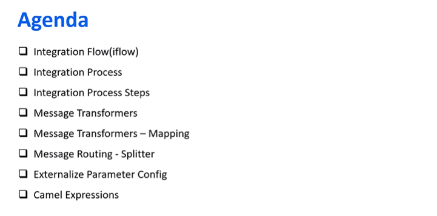

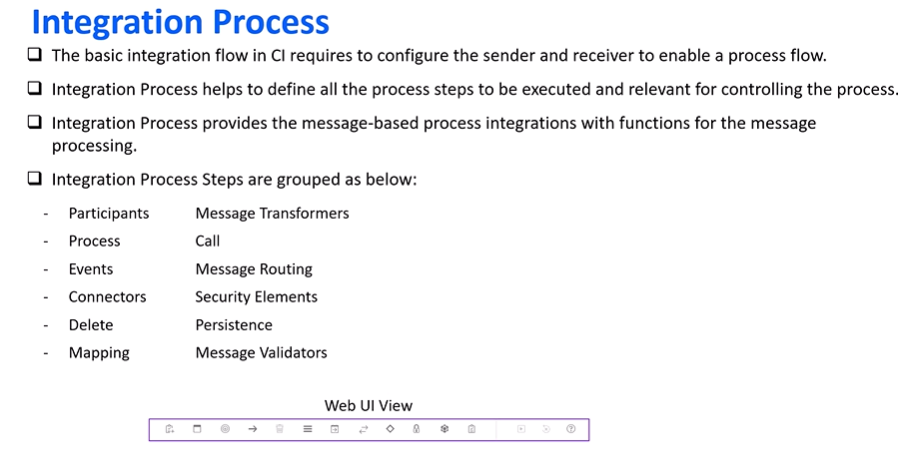

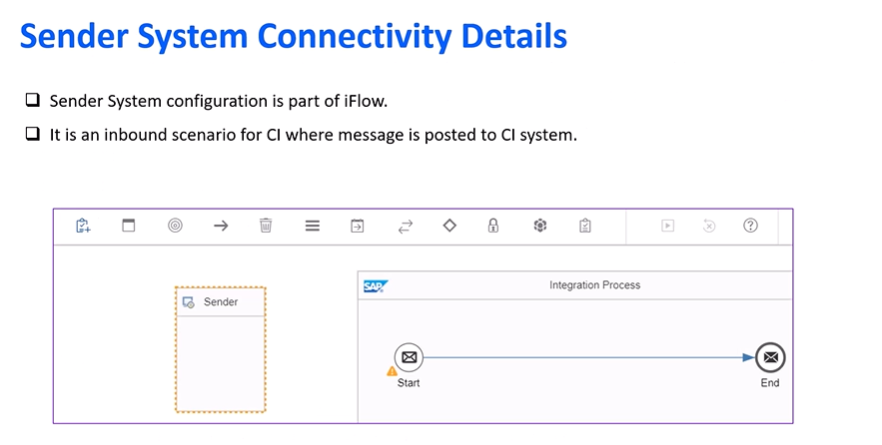

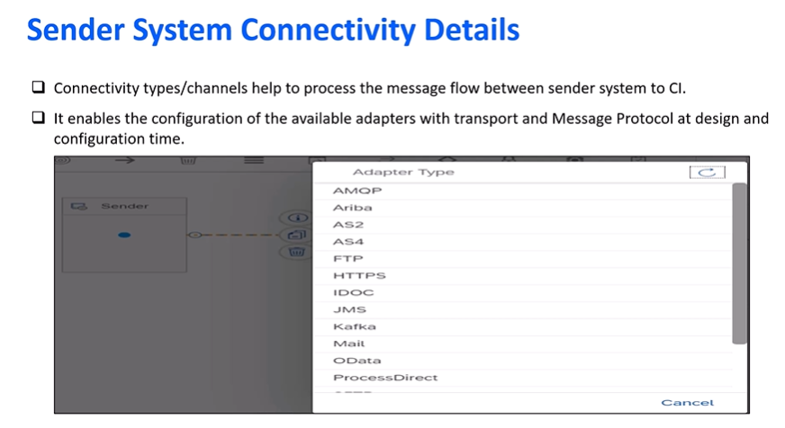

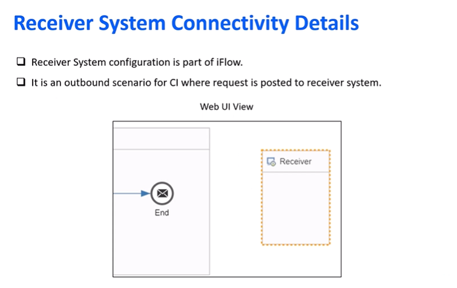

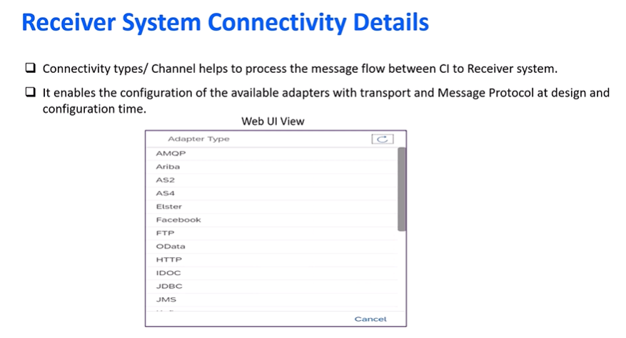

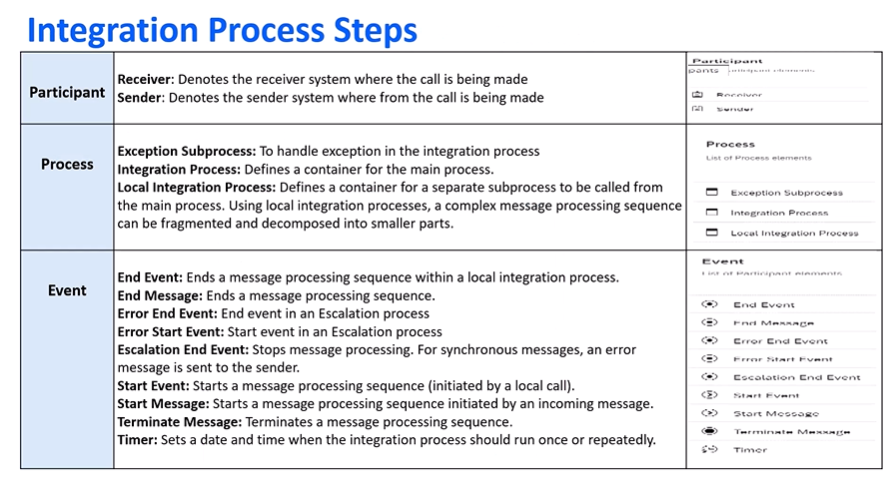

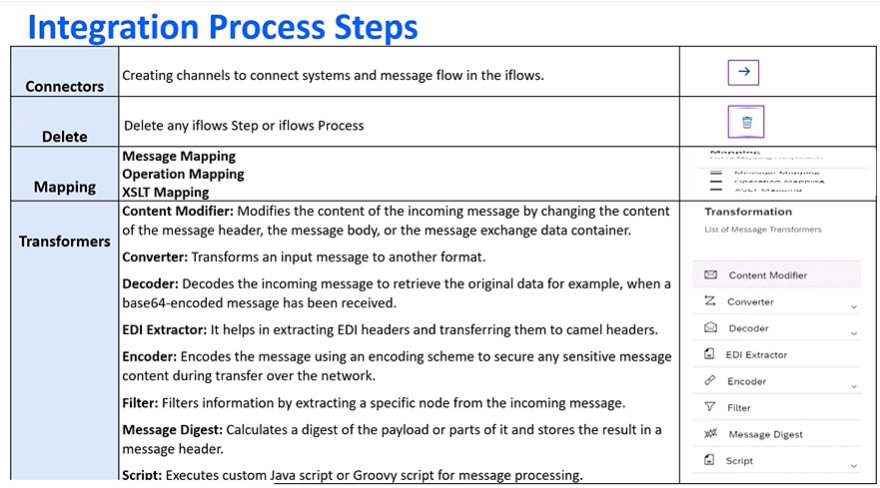

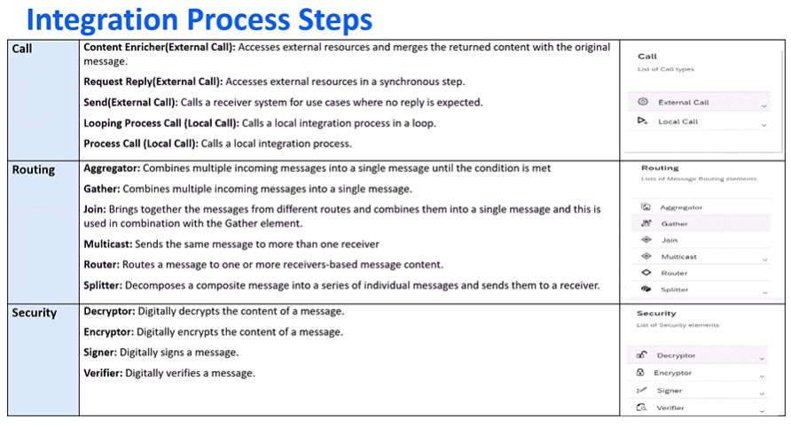

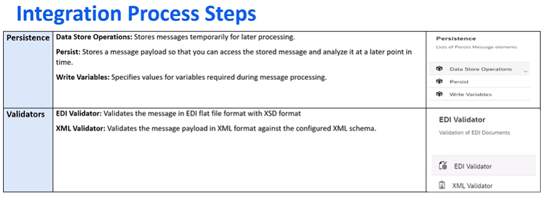

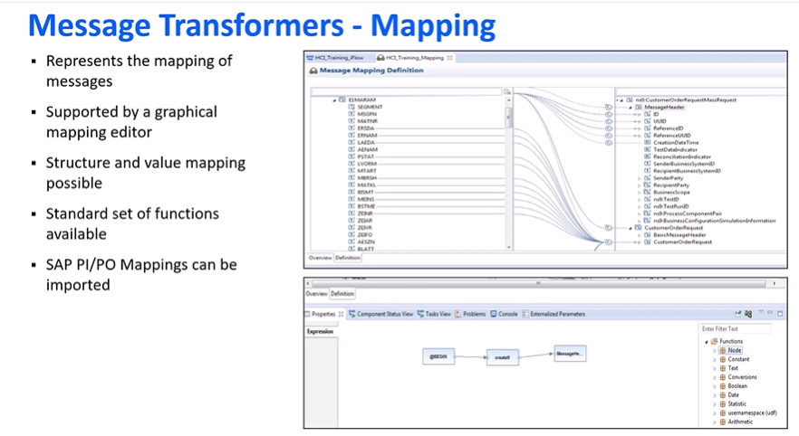

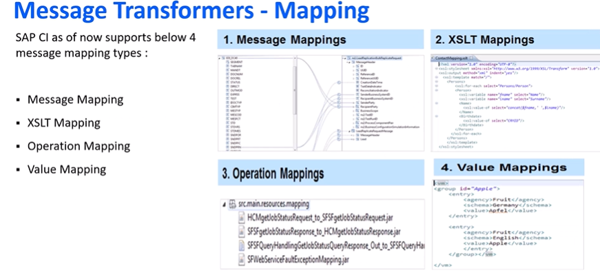

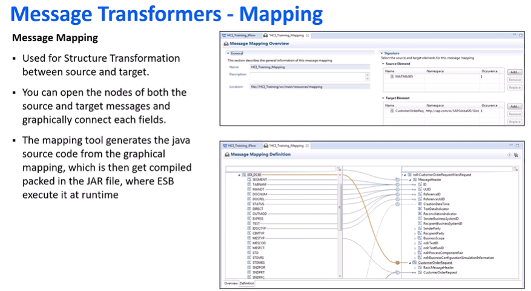

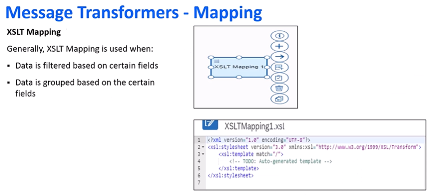

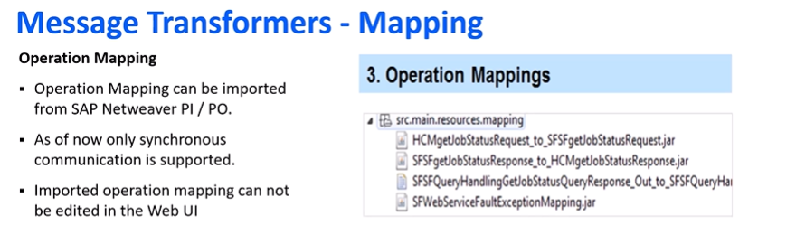

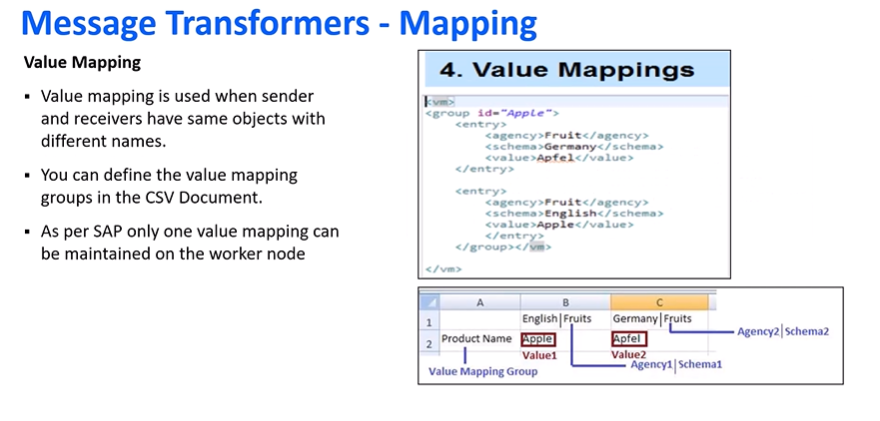

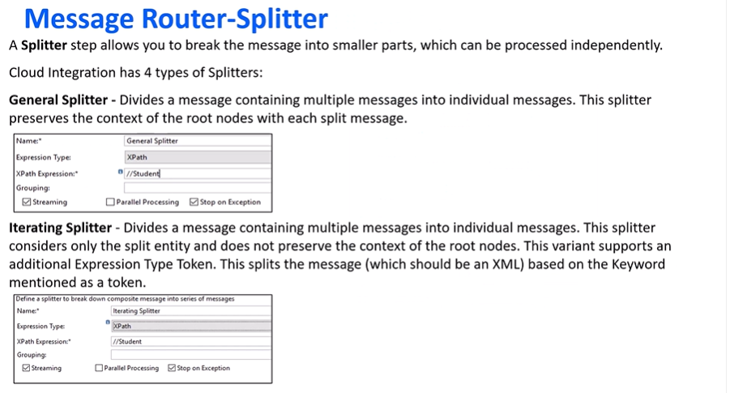

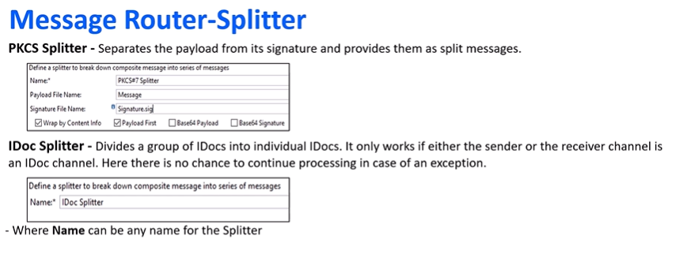

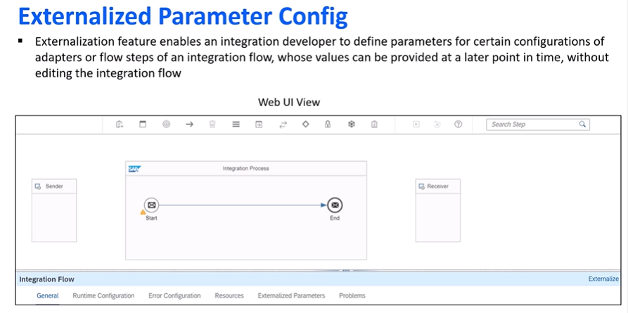

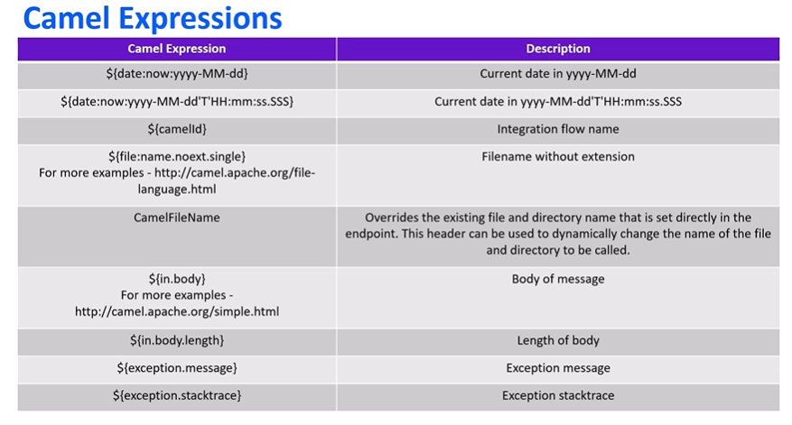

## Unit 2: Creating First Integration Flow

- Practice and learning activity: [Creating First Integration Flow](https://studyatlkm.accenture.com/mod/h5pactivity/view.php?id=24683&forceview=1)

## Unit 3: XSLT Mapping

- XSLT Mapping and its need: [SAP Help - XSLT Mapping](https://help.sap.com/saphelp_em900/helpdata/en/4b/f40f2fc0c33de4e10000000a42189e/content.htm?no_cache=true)
- Watch video: [XSLT Mapping Demo](https://studyatlkm.accenture.com/mod/h5pactivity/view.php?id=24684)

## Unit 4: Sequential and Parallel Multicast

- Reference: [Sequential and Parallel Multicast](https://www.youtube.com/watch?v=ER414LzuWKk)

## Unit 5.1: Encryption and Decryption in SAP Cloud Integration - Part 1

- Watch video: [Part 1](https://studyatlkm.accenture.com/mod/h5pactivity/view.php?id=24686)

## Unit 5.2: Encryption and Decryption in SAP Cloud Integration - Part 2

- Watch video: [Part 2](https://studyatlkm.accenture.com/mod/h5pactivity/view.php?id=24687)

## Unit 6: Message Header and Exchange Property

- Content Modifier Overview: [Define Content Modifier](https://help.sap.com/docs/cloud-integration/sap-cloud-integration/define-content-modifier)
- Watch video: [Message Header and Exchange Property](https://studyatlkm.accenture.com/mod/h5pactivity/view.php?id=24688)

## Unit 7: Local Integration Process Call

- Reference: [Local Integration Process Call](https://community.sap.com/t5/technology-blog-posts-by-members/sap-cp-is-sap-hci-looping-process-call-in-detail/ba-p/13349526)

## Unit 8: Simulation in Integration Flow

- Watch video: [Simulation in Integration Flow](https://studyatlkm.accenture.com/mod/h5pactivity/view.php?id=24690&forceview=1)

## Unit 9: Splitters

- Reference: [SAP Cloud Platform Integration - General Splitter](https://blogs.sap.com/2020/09/21/sap-cloud-platform-integration-general-splitter/)

## Unit 10: Groovy Scripts Basics

- Groovy Script Overview: [Oracle Groovy Documentation](https://docs.oracle.com/middleware/1213/odi/develop/groovy.htm)
- Watch video: [Groovy Script Basics](https://studyatlkm.accenture.com/mod/h5pactivity/view.php?id=24692&forceview=1)

## Unit 11: Groovy Scripts in Integration Flow

- Watch video: [Groovy Scripts in Integration Flow](https://studyatlkm.accenture.com/mod/h5pactivity/view.php?id=24693&forceview=1)

## Unit 12: Creating a REST API under SAP Cloud Integration

- Watch video: [REST API in SAP Cloud Integration](https://studyatlkm.accenture.com/mod/h5pactivity/view.php?id=24694&forceview=1)

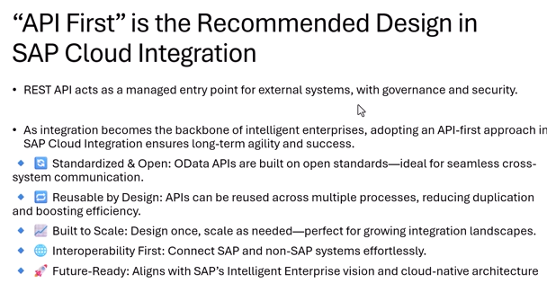

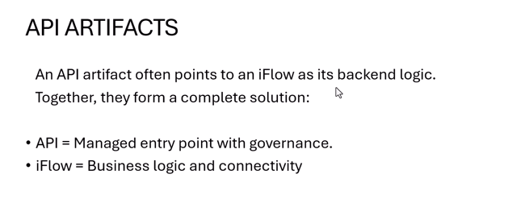

---
