# Day 14: SAP Cloud Integration Monitoring and Transport Options

**Module:** Module 10

## Unit 1: SAP Cloud Integration Monitoring and Transport Options

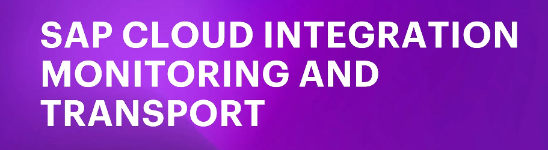

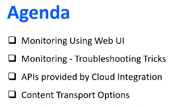

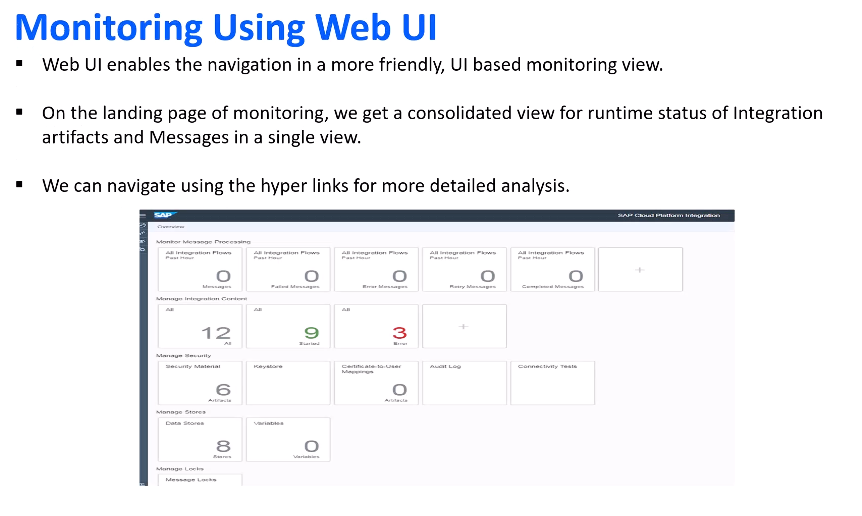

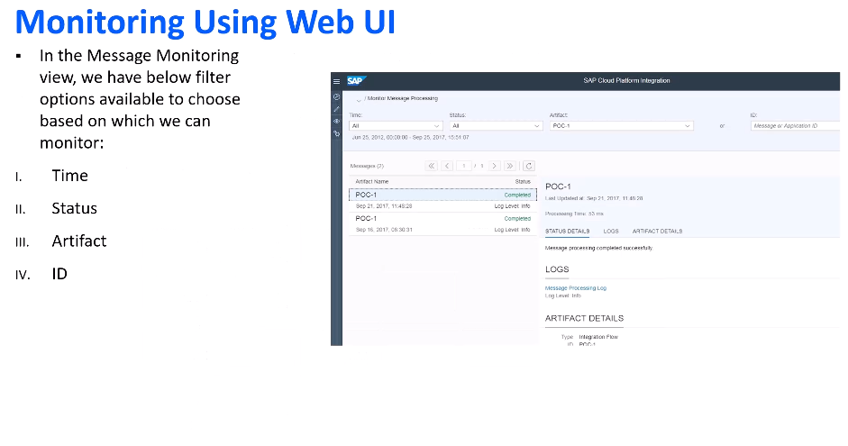

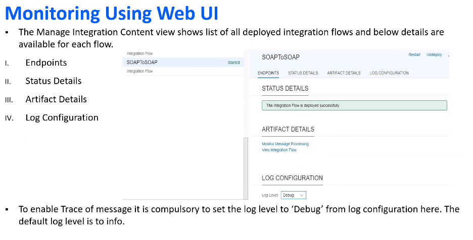

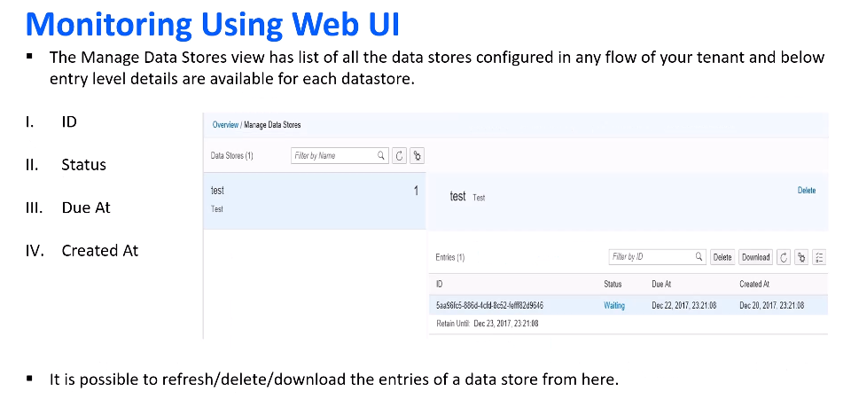

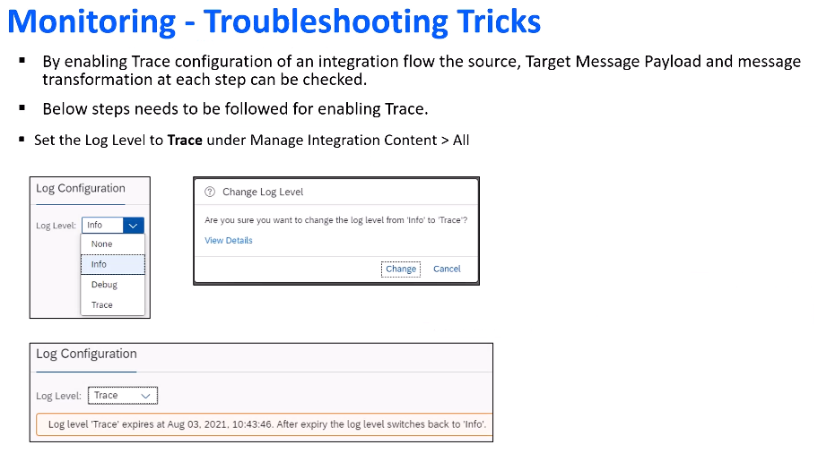

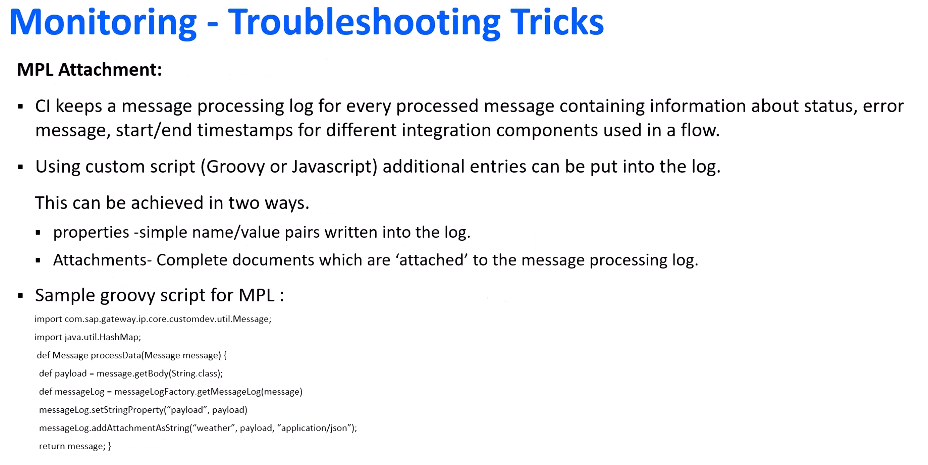

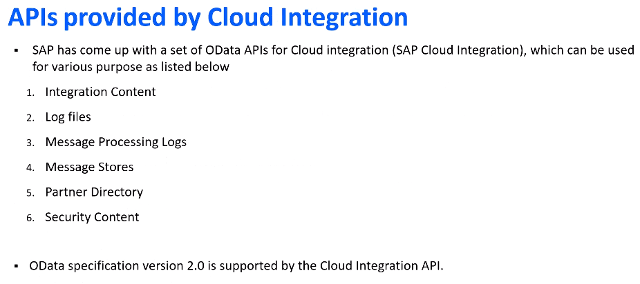

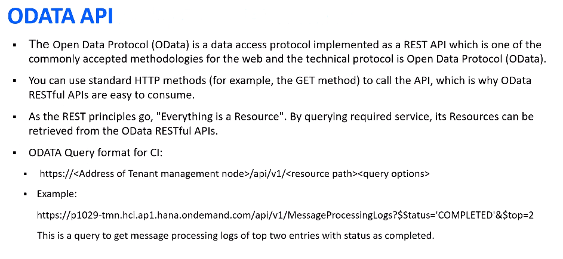

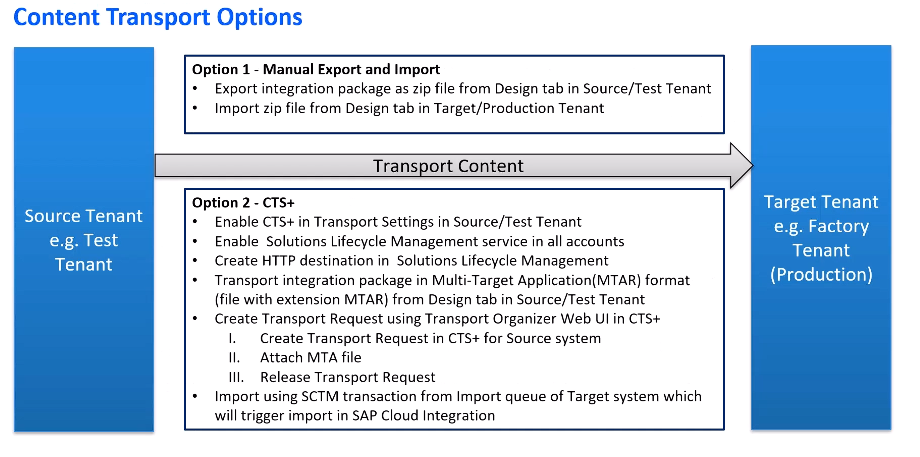

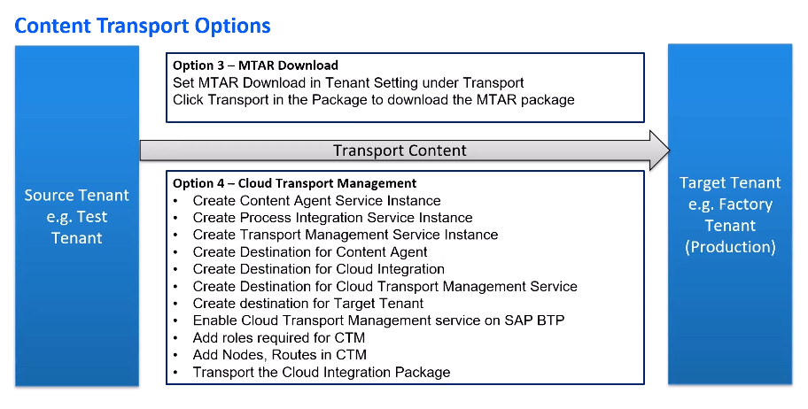

## Unit 2: Log Level Configuration

- Log Level blog: [Setting MPL Log Level at Message Level](https://community.sap.com/t5/technology-blog-posts-by-members/setting-an-mpl-log-level-at-a-message-level-in-sap-cpi/ba-p/13485995)
- Watch video: [Log Level Configuration](https://studyatlkm.accenture.com/mod/h5pactivity/view.php?id=24723)

## Unit 3: Activating Cloud Transport Management and its Configuration (Optional)

- Watch video: [Cloud Transport Management](https://studyatlkm.accenture.com/mod/h5pactivity/view.php?id=24724)

## Unit 4.1: Transporting Package using Transport Management Service - Part 1

- Watch video: [Transporting Package Part 1](https://studyatlkm.accenture.com/mod/h5pactivity/view.php?id=24725)

## Unit 4.2: Transporting Package using Transport Management Service - Part 2

- Watch video: [Transporting Package Part 2](https://studyatlkm.accenture.com/mod/h5pactivity/view.php?id=24726)

## Unit 4.3: Transporting Package using Transport Management Service - Part 3

- Watch video: [Transporting Package Part 3](https://studyatlkm.accenture.com/mod/h5pactivity/view.php?id=24727)

---

Use the `day-wise/day-14/images/` folder for screenshots, monitoring dashboards, and transport screenshots. This folder keeps all monitoring and deployment visuals separate from the main module content.
