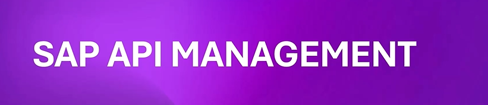
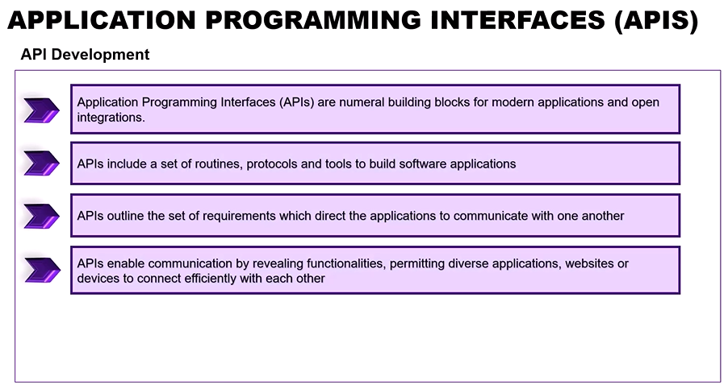
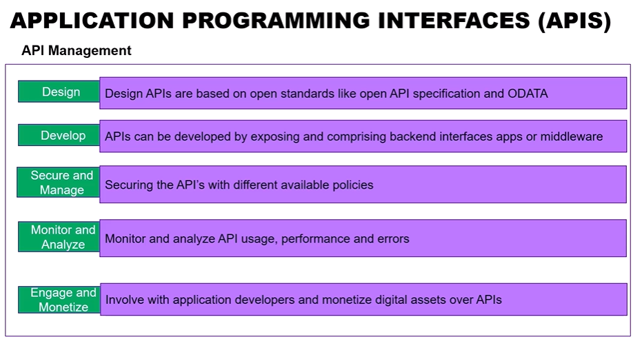
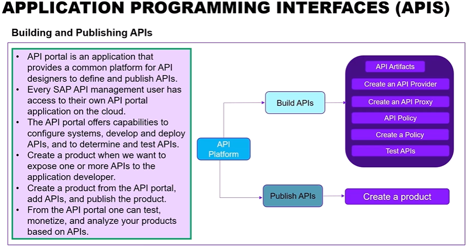
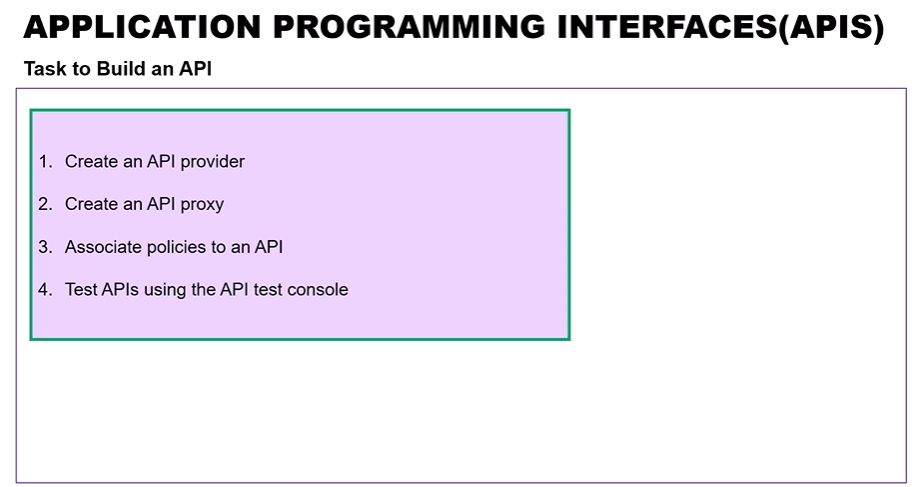
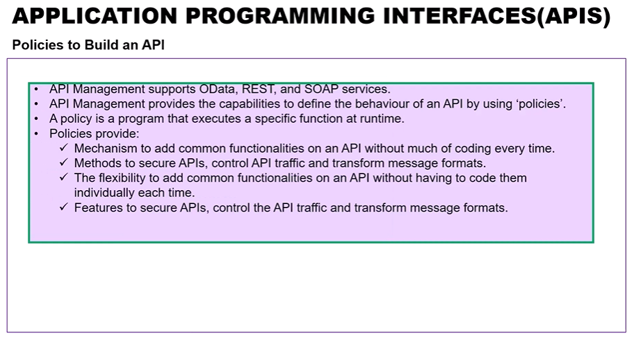
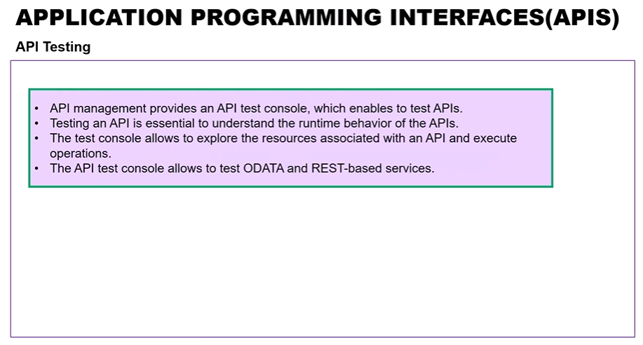
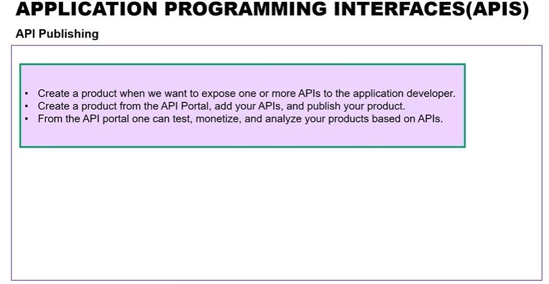

# Day 15: SAP API Management Overview

**Module:** Module 11

## Unit 1: SAP API Management

## Unit 2: Understanding API Portal

- Watch video: [Understanding API Portal](https://studyatlkm.accenture.com/mod/h5pactivity/view.php?id=24730)

## Unit 3.1: API Pre-Packaged Content - Part 1

- Watch video: [API Pre-Packaged Content Part 1](https://studyatlkm.accenture.com/mod/h5pactivity/view.php?id=24731)

## Unit 3.2: API Pre-Packaged Content - Part 2

- Watch video: [API Pre-Packaged Content Part 2](https://studyatlkm.accenture.com/mod/h5pactivity/view.php?id=24732)

## API management concepts covered

- API lifecycle and portal concepts
- API exposure and consumption patterns
- Security and policy enforcement
- API documentation and pre-packaged content

Set the API screenshots under `day-wise/day-15/images/` and keep the learning notes in this markdown file. This is the cleanest way for quick image placement and later review.
