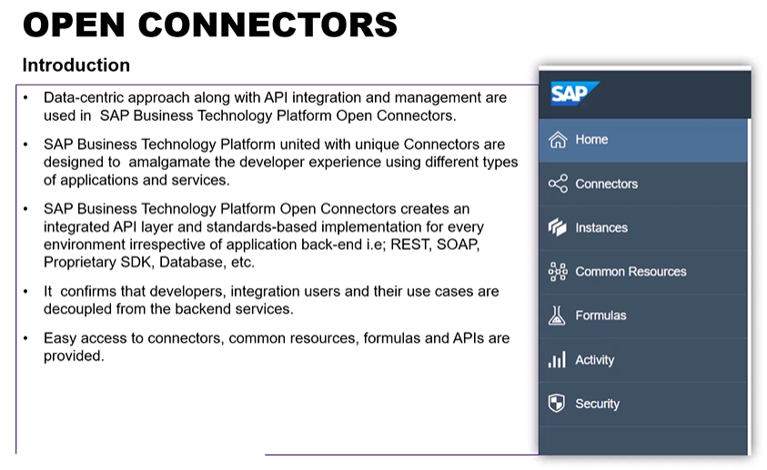
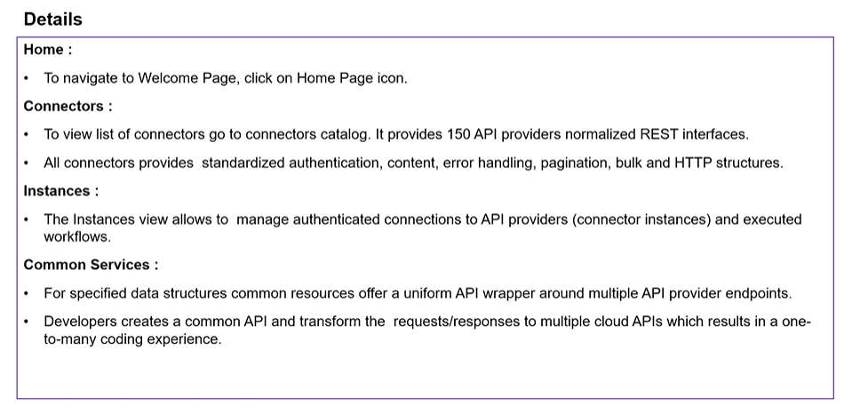
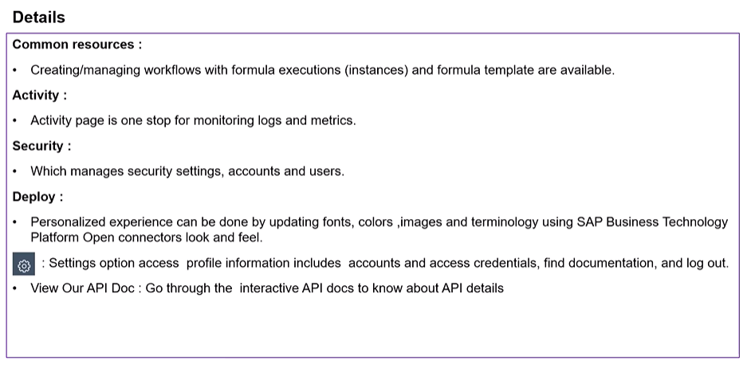
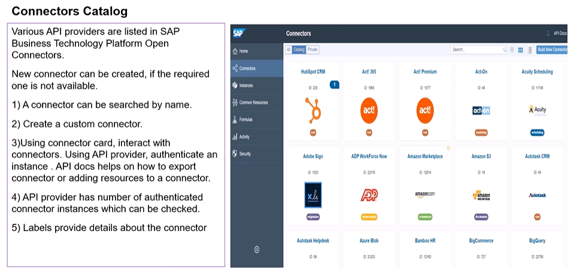
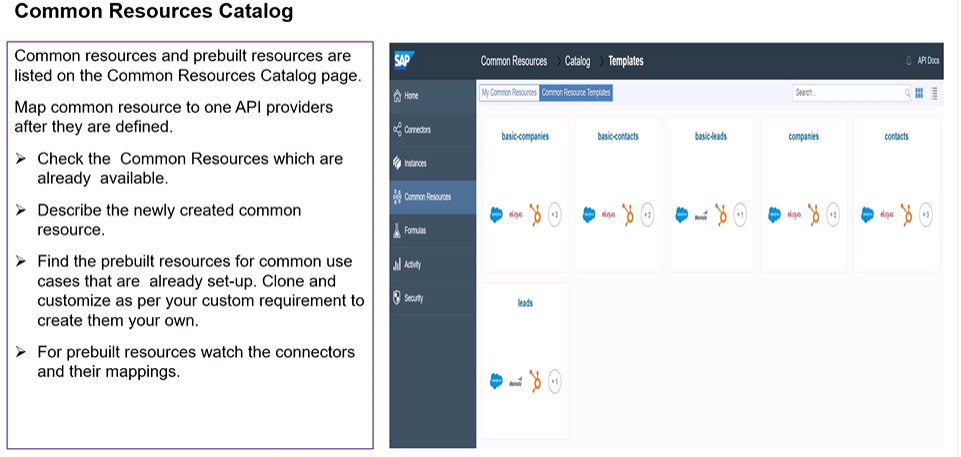
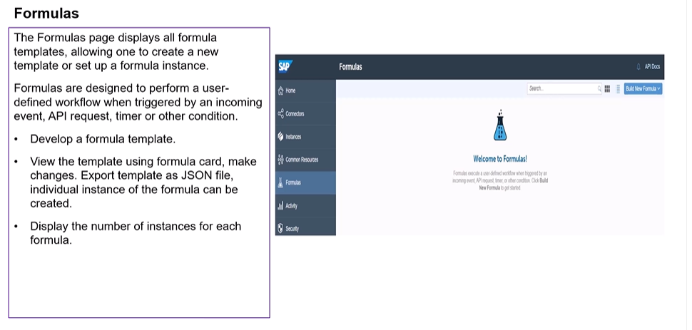

# Day 27: SAP Open Connectors

**Modules:** Modules 16, 17 and 18

## Module 16: SAP Open Connectors Overview

## Module 17: SAP Open Connectors - Connectors and Instances

### Unit 1: SAP Open Connectors - Create a Google Calendar Instance

- Watch video: [Create a Google Calendar Instance](https://studyatlkm.accenture.com/mod/h5pactivity/view.php?id=24749)

### Unit 2: Open Connector BambooHR Instance

- View PDF: [Open Connector BambooHR Instance](https://studyatlkm.accenture.com/mod/securepdf/view.php?id=24750&forceview=1)

### Unit 3: HubSpot CRM Instance Creation

- Watch video: [HubSpot CRM Instance Creation](https://studyatlkm.accenture.com/mod/h5pactivity/view.php?id=24751)

### Unit 4: QuickBooks Online Instance Creation

- Watch video: [QuickBooks Online Instance Creation](https://studyatlkm.accenture.com/mod/h5pactivity/view.php?id=24752)

### Unit 5: Build New Connector

- Watch video: [Build New Connector](https://studyatlkm.accenture.com/mod/h5pactivity/view.php?id=24753)

## Module 18: SAP Open Connectors Common Resources and Formulas

### Unit 1: Common Resource Introduction

- View resource: [Reusable Flows with Common Resources and Open Connectors](https://community.sap.com/t5/technology-blog-posts-by-members/reusable-flows-with-common-resources-and-open-connectors/ba-p/13414929)

### Unit 2: Introduction to Formula

- View resource: [Introduction to Formulas](https://help.openconnectors.ext.hana.ondemand.com/home/introduction-formulas#:~:text=In%20SAP%20Open%20Connectors%2C%20you,off%20a%20series%20of%20steps.&text=After%20you%20build%20formula%20templates,templates%20to%20create%20formula%20instances.)
