# Day 29: SAP PO to SAP Integration Suite Migration

**Module:** Module 20

## Why You Should Move to SAP Integration Suite

- Check details: [Migration Guide - Value Proposition](https://help.sap.com/docs/migration-guide-po/migration-guide-for-sap-process-orchestration/value-proposition?locale=en-US)

## SAP PO to CPI Migration Categorization

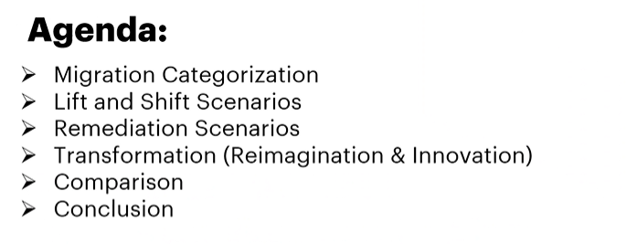

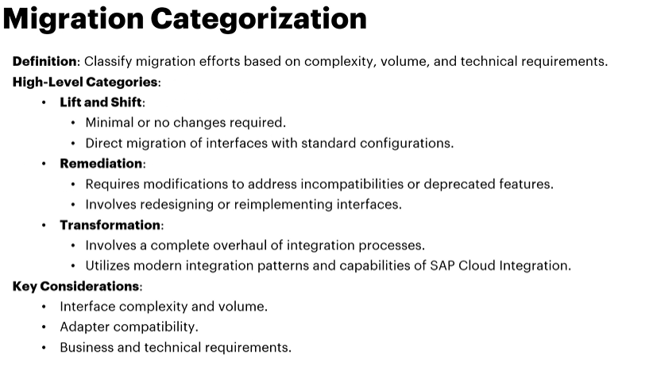

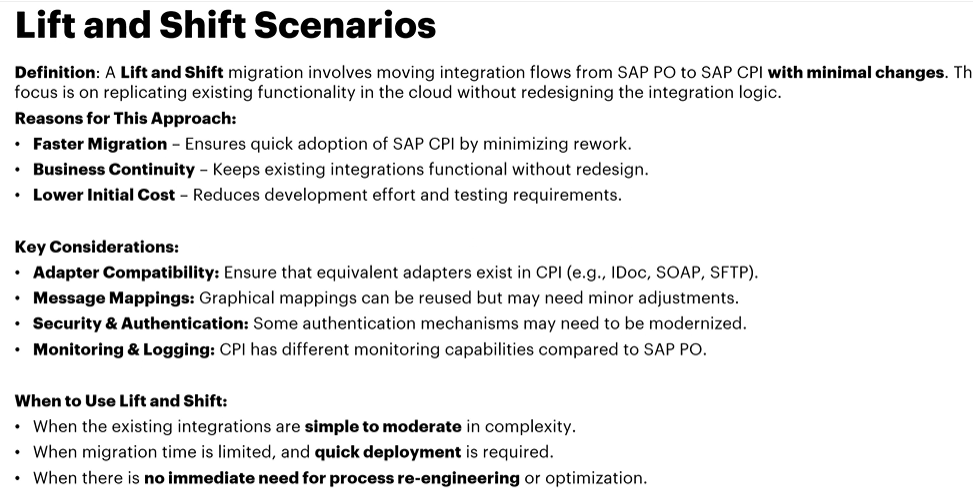

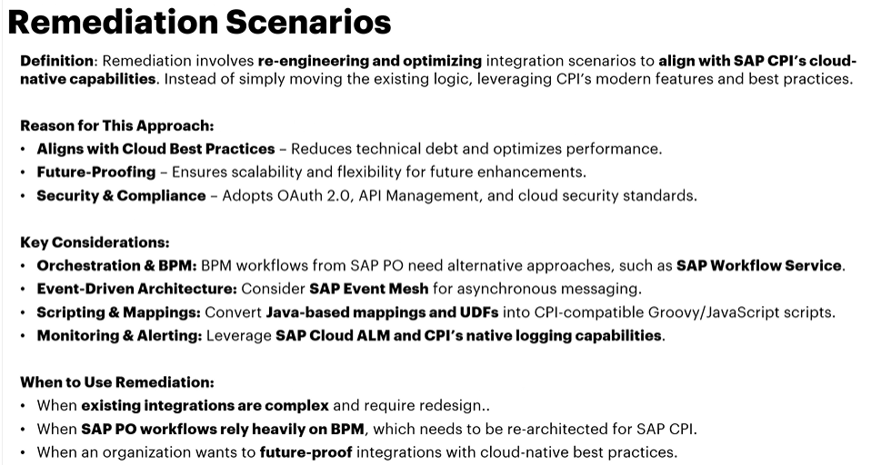

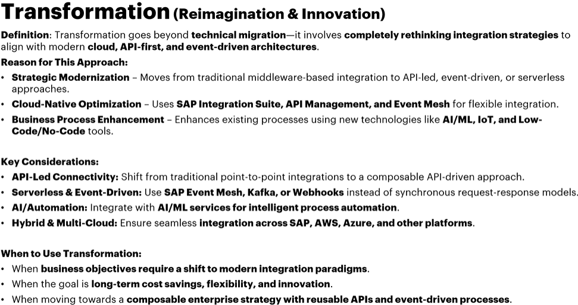

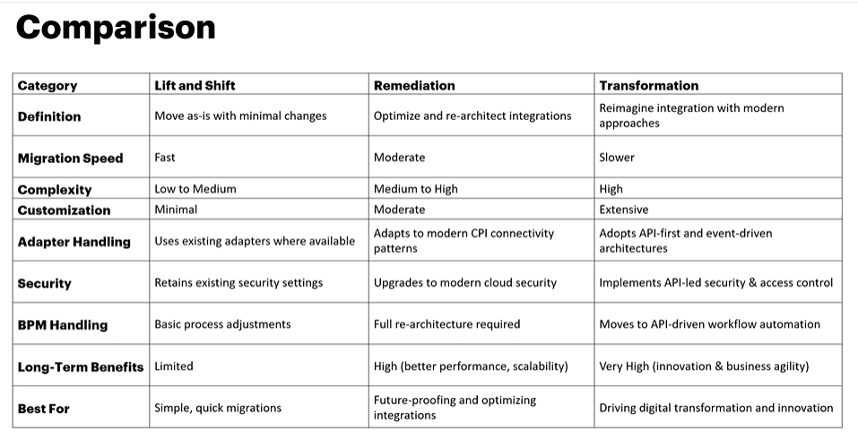

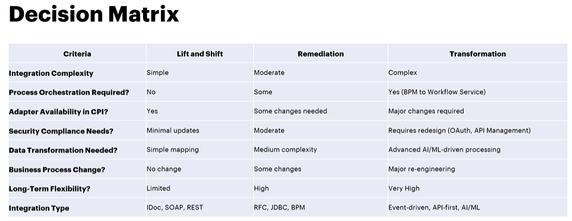

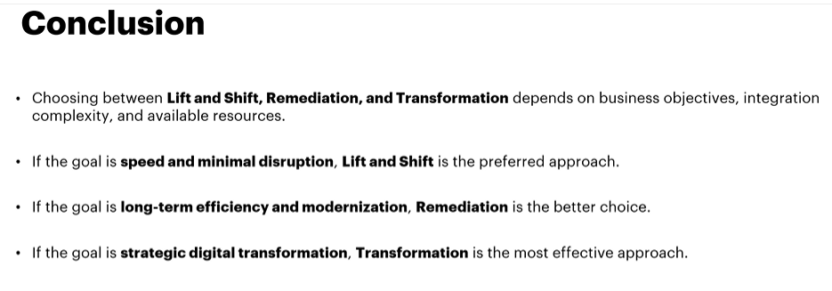

## Cloud Integration Catalyst Overview

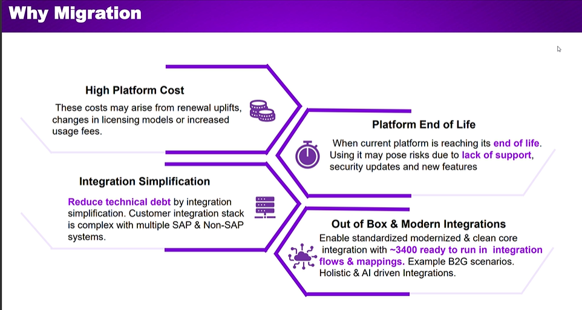

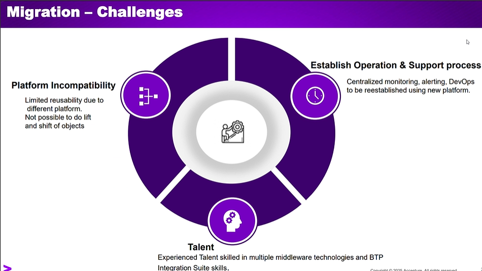

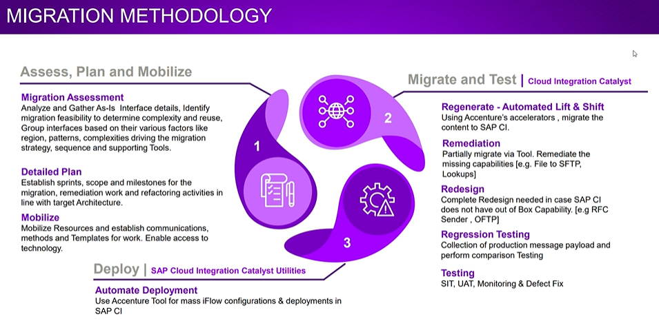

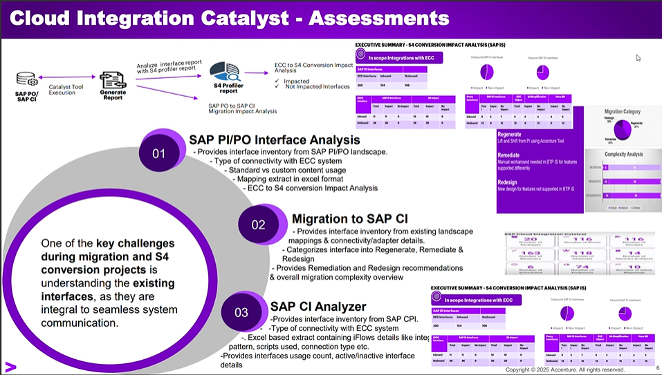

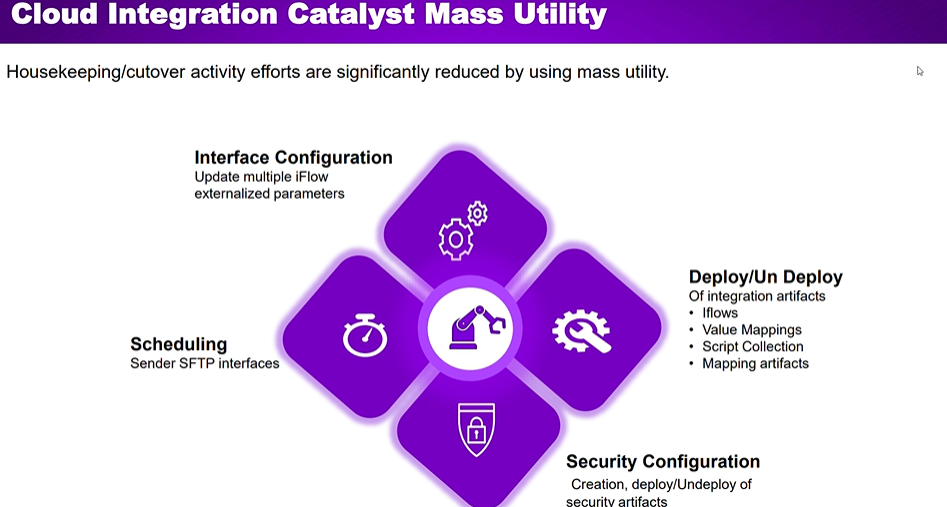

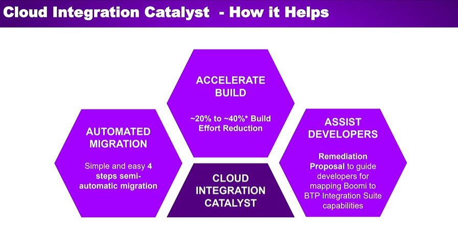

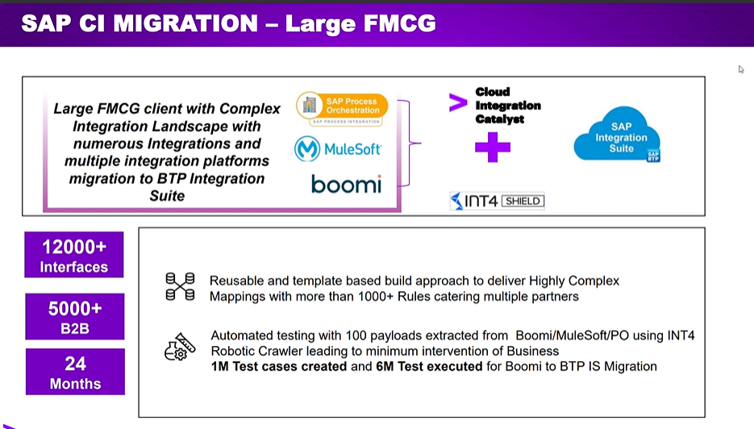

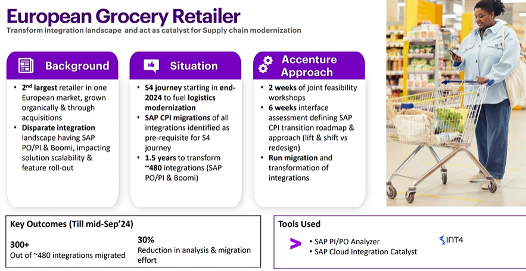

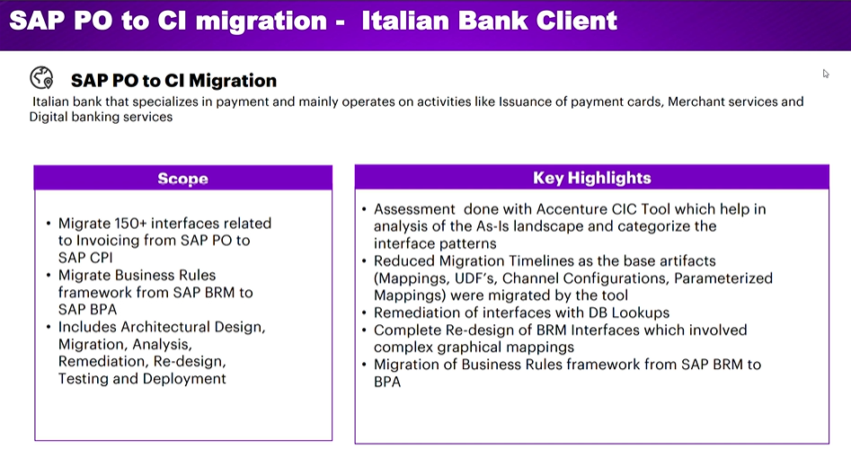

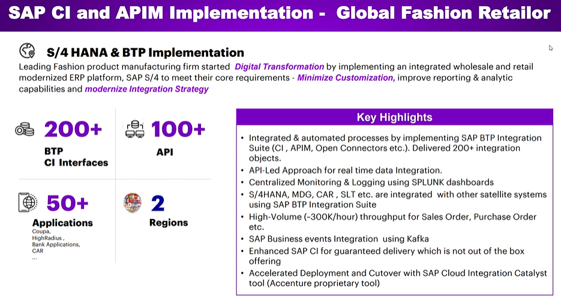

## SAP PO to SAP Integration Suite Using Cloud Integration Catalyst Demo

- Watch video: [SAP PO to SAP Integration Suite Using Cloud Integration Catalyst Demo](https://studyatlkm.accenture.com/mod/h5pactivity/view.php?id=24761)

## SAP PO to SAP BTP Integration Suite Migration Challenges and Learnings

- Watch video: [SAP PO to SAP BTP Integration Suite Migration Challenges and Learnings](https://studyatlkm.accenture.com/mod/h5pactivity/view.php?id=24762)
